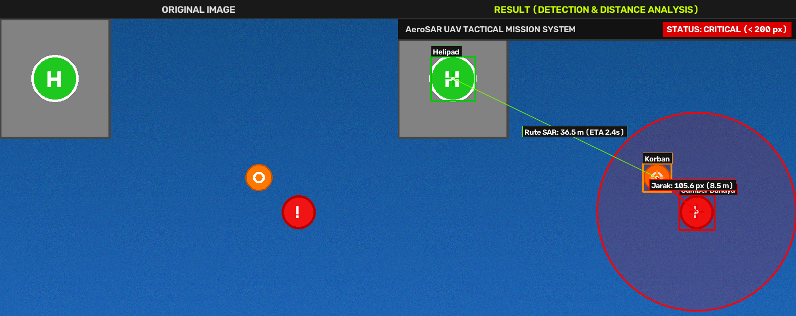
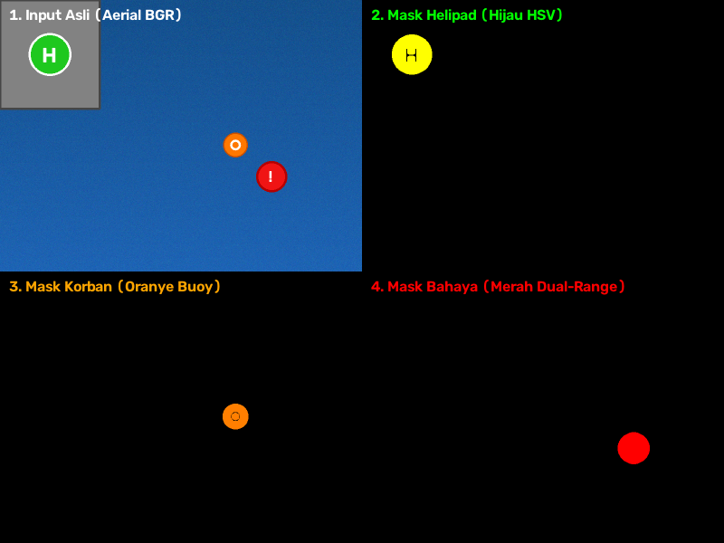

# 🚁 AeroSAR UAV Tactical Mission Control & Vision System

[](https://www.python.org/)
[](https://opencv.org/)
[](https://flask.palletsprojects.com/)
[](LICENSE)

Sistem visi komputer (*Computer Vision*) dan stasiun kendali darat (*Ground Control Station / GCS*) untuk drone SAR (*Search and Rescue*) maritim. Sistem ini bertugas mendeteksi target pangkalan (**Helipad**), **Korban** kecelakaan kapal, dan **Sumber Bahaya**, menghitung jarak spasial (piksel dan meter), mengevaluasi perimeter keselamatan (**CRITICAL / SAFE**), serta mengestimasi rute pengantaran bantuan darurat UAV.

---

## 📸 Tampilan Antarmuka & Hasil Deteksi

### 1. Hasil Deteksi Berdampingan (*Side-by-Side View*)


### 2. Tahap Pipeline Segmentasi Visi (*Vision Pipeline Inspector*)


---

## ✨ Fitur Utama

- **Deteksi 3 Target Utama**:
  - `Helipad`: Pangkalan drone pada dermaga pelabuhan (*green circular pad with 'H'*).
  - `Korban`: Korban terapung di perairan (*international orange safety buoy*).
  - `Sumber Bahaya`: Ancaman laut (*red dual-range hazard zone*).
- **Anotasi Lengkap**: *Bounding box*, label target berlatar kontras, serta tanda `+` (*crosshair marker*) pada titik berat (*centroid* $M_{10}/M_{00}, M_{01}/M_{00}$).
- **Pengukuran Jarak Spasial**: Jarak Euclidean langsung antara Korban dan Sumber Bahaya:
  $$d = \sqrt{(x_k - x_b)^2 + (y_k - y_b)^2}$$
- **Evaluasi Ambang Batas Keselamatan**:
  - `CRITICAL`: Jarak $< \text{threshold}$ (garis merah menyala & alarm bahaya).
  - `SAFE`: Jarak $\ge \text{threshold}$ (garis cyan/kuning).
- **Danger Buffer Zone Ring**: Lingkaran perimeter transparan di sekeliling sumber bahaya untuk mendeteksi *zone breach*.
- **Kalibrasi Fisik GSD (*Ground Sampling Distance*)**: Konversi otomatis satuan piksel ke meter nyata ($1\text{ px} \approx 0.08\text{ m}$).
- **Kalkulasi Rute Terbang UAV**: Estimasi jarak Helipad $\rightarrow$ Korban dan waktu tiba (*ETA*) pengedroppan bantuan darurat.
- **Aplikasi Web GCS Interaktif**:
  - Drag & Drop file gambar (.png, .jpg, .jpeg, .bmp).
  - Mode Geser Tirai (*Interactive Split-Screen Curtain Slider*).
  - Uji ketahanan cuaca: *Cerah*, *Kabut Laut (Sea Fog)*, *Senja (Dusk)*, dan *Ombak Kuat (Rough Waves)*.
  - Berita Acara Misi SAR resmi siap cetak / PDF.
  - Alarm akustik sonar radar (Web Audio API).

---

## 🛠️ Panduan Instalasi & Menjalankan

### 1. Kloning Repositori
```bash
git clone https://github.com/USERNAME/REPO_NAME.git
cd REPO_NAME
```

### 2. Pasang Dependensi
```bash
pip install -r requirements.txt
```

### 3. Menjalankan Aplikasi Web GCS
```bash
python3 app.py
```
Buka browser di: **`http://localhost:5000`**

### 4. Menjalankan Mode CLI (Terminal)
```bash
# Menjalankan simulasi bawaan:
python3 sar_drone_detector.py

# Menjalankan dengan citra sendiri:
python3 sar_drone_detector.py --image path/ke/foto_drone.jpg --threshold 200
```

---

## 📁 Struktur Berkas

```text
├── assets/                  # Gambar dokumentasi & preview README
├── output/                  # Direktori hasil ekspor citra
├── app.py                   # Aplikasi Web GCS (Flask + Modern Aerospace UI)
├── sar_drone_detector.py    # Modul Engine Computer Vision OpenCV
├── sar_drone_detector.cpp   # Implementasi C++ OpenCV
├── generate_samples.py      # Generator citra simulasi multi-cuaca
├── requirements.txt         # Daftar dependensi Python
├── .gitignore               # Aturan ignore berkas sementara
└── README.md                # Dokumentasi proyek
```

---

## 📜 Lisensi

Proyek ini dirilis di bawah lisensi [MIT](LICENSE).
